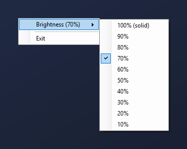

# Windows Hello Brightener

**Make Windows Hello face recognition work in the dark.**

When a Windows Hello or passkey prompt appears, your screen lights up around it so the camera can see your face. Made for the **Tobii Eye Tracker 5**, and it helps any Windows Hello camera in low light.


## Features

- ⚡ **No setup:** run it once and it starts automatically with Windows from then on.
- 🔑 **Works everywhere:** passkeys in any browser, app sign-ins, and any Windows Security prompt.
- 🔆 **Adjustable brightness:** 10% to 100%, starting at 70%.
- 🎯 **Stays out of the way:** click-through, never steals focus, and fits the prompt exactly.
- 🪶 **Tiny and private:** an 18 KB app with no admin rights, no internet and no data collection.

## Install

1. Download **`HelloBrightener.exe`** from the [latest release](../../releases/latest).
2. Double-click it.

That's it. It installs itself, **runs on startup automatically**, and sits in your system tray as a 🛡️ shield icon.

> Windows SmartScreen may warn that the app is unrecognised because it isn't code-signed. Click **More info → Run anyway**, or [build it yourself](#build-from-source).

## Brightness

Right-click the 🛡️ tray icon → **Brightness**. Each choice previews for 3 seconds and is remembered.



Lower is easier on your eyes; higher gives the camera more light. If recognition is slow in the dark, go up a step.

## Uninstall

Use either of these. Both close the app and remove everything it changed:

- **Settings → Apps → Installed apps → Windows Hello Brightener → Uninstall**
- Or run **`Uninstall.exe`** in the app's folder (press **Win + R** and open `%LOCALAPPDATA%\HelloBrightener`).

## Why the Tobii Eye Tracker 5 needs this

The Tobii Eye Tracker 5's face recognition often fails or takes ages in a dark room but works instantly with a light on. Windows Hello prompts are small dark windows, so your face gets almost no light at the moment the camera needs it. Lighting up the screen behind the prompt fixes that.

**Tip:** this app can't draw on the lock screen, because Windows protects it. For the lock screen, use a bright lock screen picture (*Settings → Personalization → Lock screen*).

## Build from source

No tools needed: Windows already includes the C# compiler. In PowerShell, from the repo folder:

```powershell
powershell -ExecutionPolicy Bypass -File .\build.ps1 -Install
```

Leave off `-Install` to only build `HelloBrightener.exe`.

<details>
<summary><b>How it works</b></summary>

- It checks a few times per second for the Windows Hello dialog (`CredentialUIBroker.exe`, window class `Credential Dialog Xaml Host`).
- When it finds one, it shows a click-through, non-activating white overlay on that monitor, with a rounded cut-out matching the dialog at any display scaling.
- On first run it copies itself to `%LOCALAPPDATA%\HelloBrightener`, adds itself to the per-user startup list, and registers in *Installed apps*. Settings are stored in `HKEY_CURRENT_USER\Software\HelloBrightener`.

All the code is in one file: [`src/HelloBrightener.cs`](src/HelloBrightener.cs).

</details>

## Requirements

Windows 10 or 11 and a Windows Hello face camera (Tobii Eye Tracker 5, laptop IR camera, Hello webcam).

## License

[MIT](LICENSE)
