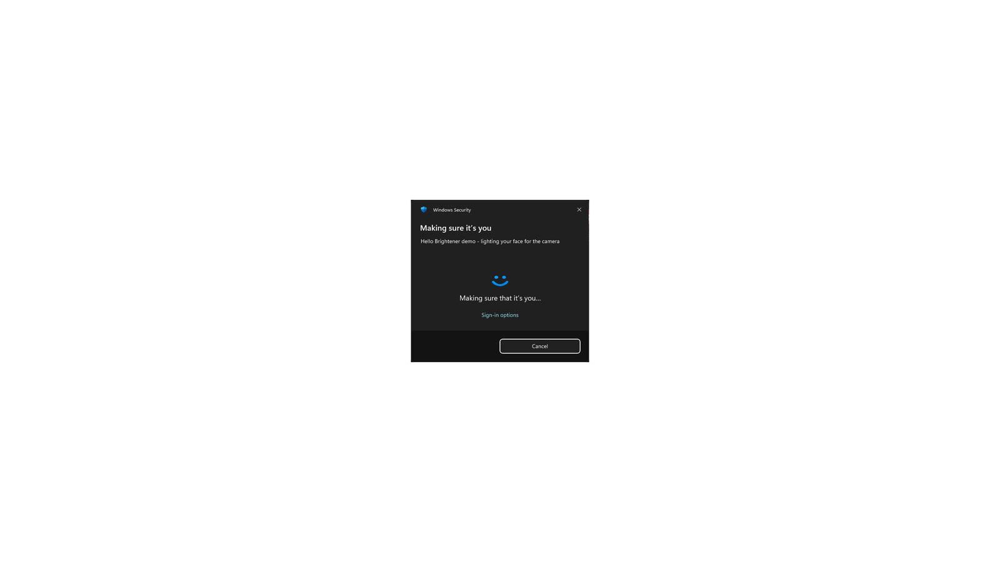

# Hello Brightener: Windows Hello face recognition that works in the dark

**Windows Hello face unlock failing in a dark room? Hello Brightener turns your screen white around Windows Hello prompts so the camera can see your face.**

Made for the **Tobii Eye Tracker 5**. Its Windows Hello face recognition struggles in the dark, and extra light on your face fixes it. It also helps any other Windows Hello camera that has trouble in low light.



## What it does

When any **Windows Security / Windows Hello** prompt appears, Hello Brightener fades the rest of that monitor to **pure white**. Your monitor becomes a big soft light pointed at your face. When the prompt closes, the white disappears and your screen goes back to normal.

It works with:

- 🔑 **Passkeys** in Chrome, Edge, Firefox, Brave and others ("Sign in with a passkey")
- 🔐 Apps that ask you to **verify it's you** with Windows Hello (password managers, Microsoft Store, Settings and more)
- 🪟 Any other prompt that uses the Windows Security dialog

It is designed to stay out of your way:

- **Click-through, never takes focus.** The prompt stays fully usable, so you can still type your PIN or press Cancel.
- **Only covers the monitor the prompt is on.** Your other screens are untouched.
- **Tiny and idle.** One small `.exe` with no dependencies that just checks for the prompt a few times per second.
- **No network access, no data collection, no admin rights needed.**

## Why the Tobii Eye Tracker 5 needs this

The Tobii Eye Tracker 5 supports Windows Hello face recognition, but many people find it **fails or takes ages in a dark room** and works instantly with a light on. Monitors are bright, but most Windows Hello prompts are small dark dialogs, so your face gets very little light at exactly the moment the camera needs it.

Hello Brightener makes the whole screen behind the prompt white, so your face is evenly lit and recognition works first time, even with the room lights off.

## Install

**Option A: download (easiest)**

1. Download `HelloBrightener.exe` from the [latest release](../../releases/latest).
2. Put it somewhere permanent, for example `%LOCALAPPDATA%\HelloBrightener\`.
3. Run it. A 🛡️ shield icon appears in your system tray.
4. *(Optional)* To start it automatically: press **Win + R**, type `shell:startup`, and put a shortcut to the `.exe` in that folder.

> Windows SmartScreen may warn about an unknown publisher because the exe isn't code-signed. If you'd rather not run a downloaded exe, use Option B. It builds the same exe from the source in this repo in a few seconds.

**Option B: build it yourself (no tools to install)**

Windows already includes the C# compiler this needs. In PowerShell, from the repo folder:

```powershell
powershell -ExecutionPolicy Bypass -File .\build.ps1 -Install
```

This builds `HelloBrightener.exe`, installs it to `%LOCALAPPDATA%\HelloBrightener`, adds it to startup, and starts it. Leave off `-Install` to only build the exe.

## Usage

Nothing to do. It runs in the tray and kicks in on its own. Right-click the tray icon for:

- **Test white frame (3 s):** shows the white frame without a real prompt, so you can see it working.
- **White strength:** 100% (solid), 90%, 75%, 50% or 25%. Lower values make the frame **translucent**, so the desktop shows through. Use this to calibrate for your monitor: a very bright monitor may need less than 100%. Picking a value previews it for 3 seconds, and your choice is remembered.
- **Exit:** closes the app.

## Bonus tip: the Windows lock screen

Hello Brightener can't draw on the **lock screen** or on **UAC prompts**. Windows shows those on a protected desktop that no app is allowed to draw on. For the lock screen, use a **bright or white lock screen picture** instead: *Settings → Personalization → Lock screen → Picture*. Make sure *"Show the lock screen background picture on the sign-in screen"* is turned on. With a Tobii Eye Tracker 5 this makes unlocking in the dark much more reliable.

## Uninstall

1. Right-click the tray icon → **Exit**.
2. Press **Win + R**, type `shell:startup`, and delete `HelloBrightener.lnk` (or the shortcut you made).
3. Delete the `HelloBrightener` folder.
4. *(Optional)* Delete the saved setting at `HKEY_CURRENT_USER\Software\HelloBrightener`.

## How it works

- Every ~120 ms it looks for a visible window belonging to `CredentialUIBroker.exe`, the process behind the Windows Security / Windows Hello dialog, or with the class `Credential Dialog Xaml Host`.
- When it finds one, it shows a borderless, topmost, **click-through, non-activating** white window over that monitor, with a hole cut out exactly where the dialog is. It is per-monitor DPI aware, so the hole lines up on scaled displays.
- When the dialog closes, the overlay hides.

All the code is in a single file: [`src/HelloBrightener.cs`](src/HelloBrightener.cs).

## Requirements

- Windows 10 or Windows 11
- A Windows Hello face camera: Tobii Eye Tracker 5, laptop IR camera, Windows Hello webcam and so on
- .NET Framework 4.x, which is built into Windows

## Keywords

Windows Hello not working in the dark · Windows Hello face recognition low light · Tobii Eye Tracker 5 Windows Hello dark room · passkey face unlock dark · Windows Hello IR camera fails at night · brighten screen for Windows Hello

## License

[MIT](LICENSE)
